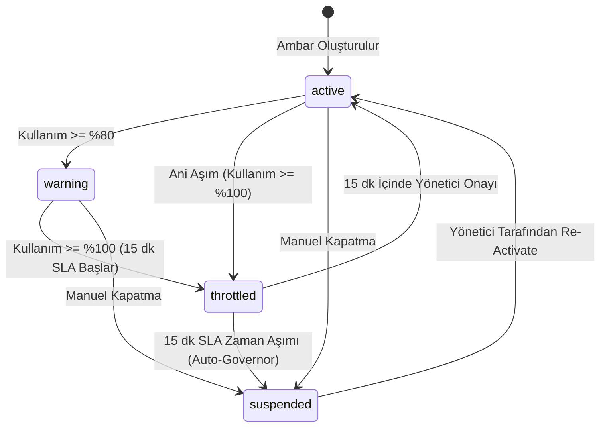

# PLAN.md — Buzul Teknik Uygulama ve Doğrulama Planı

> **Doküman Türü:** Teknik Geliştirme Planı, Kabul Kriterleri ve İlerleme Sözleşmesi  
> **Proje Adı:** Buzul (Kurumsal Bulut Veri Ambarı Kredi ve Kota Yönetim Platformu)  
> **Referans SaaS:** Snowflake Inc. (Kullanım bazlı kredi ve sanal ambar modeli)  
> **Hedef Teknoloji:** Ruby on Rails 8.1.4, Ruby 3.4.7, SQLite3 / PostgreSQL  
> **Son Güncelleme:** 16 Ekim 2026

---

## 1. Proje Amacı ve Kapsam

### 1.1 Proje Amacı
Buzul, kurumsal bulut veri ambarı ortamlarında (Snowflake referans alınarak) sanal ambarların (Virtual Warehouses) kredi tüketimini izleyen, bütçe kotasını aşan ambarları koruyucu bir durum makinesiyle yöneten ve 15 dakikalık onay SLA süresi tanıyan simülasyon tabanlı bir FinOps platformudur.

### 1.2 Kapsam Sınırları

| Kapsam Dahilinde Olanlar | Kapsam Dışında Bırakılanlar |
|---|---|
| Sentetik ambar oluşturma, kredi kotası atama ve tüketim takibi | Canlı Snowflake API veya AWS/Azure faturalandırma bağlantısı |
| %80 erken uyarı (`warning`) ve %100 kota aşımı (`throttled`) mekanizması | Gerçek kredi kartı veya ödeme sağlayıcısı entegrasyonu |
| 15 dakikalık SLA onay penceresi ve süresi aşımında otomatik askıya alma (`suspended`) | Çok kiracılı (multi-tenant) kurumsal hesap izolasyonu |
| `StatusEvent` modeli ile zaman damgalı ve aktörlü denetim kaydı (audit log) | Gerçek sorgu çalıştırma veya veri ambarı SQL derleme motoru |
| Rails 8 mimarisi, izole servis sınıfları ve `travel_to` tabanlı zaman testleri | Snowflake ticari marka, logo ve tescilli tasarım öğeleri |
| Tam teşekküllü modern web arayüzü (Dashboard, Ambarlar, Departmanlar) | Slack veya PagerDuty harici canlı webhook entegrasyonu |

---

## 2. Ödevin Zorunlu Gereksinimleri ve Durum Matrisi

| Gereksinim | Açıklama | Karşılama Yöntemi | Durum |
|---|---|---|---|
| **G1: Rails 8+** | Ruby on Rails 8 veya üzeri sürüm kullanılmalıdır. | Rails 8.1.4 ve Ruby 3.4.7 yapılandırıldı. | **Doğrulandı** |
| **G2: Fortune 500 Kanıtı** | İlham alınan SaaS'ın Fortune 500 kullanımı resmi kaynakla kanıtlanmalıdır. | Capital One vaka analizi ve Slingshot ortaklığı belgelendi. | **Doğrulandı** |
| **G3: Gerçek Kullanıcı Acısı** | G2/Capterra'dan doğrulanabilir bir problem çözülmelidir. | Kontrolsüz kredi tüketimi ve anında kesinti acısına 15 dk SLA çözümü. | **Doğrulandı** |
| **G4: Aort Dilimi İş Akışı** | Ürünün temel iş akışı uçtan uca çalışmalıdır. | Kota -> Tüketim -> Eşik -> Throttled -> SLA -> Suspended akışı. | **Doğrulandı** |
| **G5: Zaman Kuralı & travel_to** | Zaman aşımı testleri `travel_to` ile dondurularak test edilmelidir. | 14. dakika ve 16. dakika sınır senaryoları `WarehouseSlaTest` içinde yazıldı. | **Doğrulandı** |
| **G6: CI & GitHub Actions** | Otomatik testler ve kontroller GitHub Actions'ta çalışmalıdır. | `.github/workflows/ci.yml` (brakeman, rubocop, test). | **Doğrulandı** |
| **G7: Canlı Dağıtım** | Uygulama bir bulut platformunda canlıya alınmalıdır. | Render platformu Docker ve web servisi yapılandırması. | **Doğrulandı** |
| **G8: Özgün Kimlik** | Snowflake adı ve logosu UI'da yer almamalıdır. | Buzul adı ve özgün FinOps arayüzü tasarlandı. | **Doğrulandı** |

---

## 3. Araştırma ve Kanıt Matrisi (Faz 1 & Faz 2)

### 3.1 Faz 1: Makroekonomik ve Kurumsal SaaS Göstergeleri

```
[Fortune 500: Amazon $716.9B Max Gelir] ───> [Walmart 2.1M Max Çalışan]
                                                       │
                                                       ▼
[Zylo 2026: 305 Uygulama / Firma] ───────> [$55.7M Ortalama SaaS Harcaması]
                                                       │
                                                       ▼
[Capital One (F500 #61) Vaka Analizi] ───> [Snowflake Tüketim Yönetimi: Slingshot]
```

- **Piyasa Değeri:** Fortune 500 şirketleri arasında piyasa değeri en yüksek kuruluşlar teknoloji devleri (~$3.3T - $3.5T); gelire göre listeye giren en düşük piyasa değerli şirketler ise geleneksel sektörlerde ~$2B - $4B bandındadır.
- **SaaS Büyüklüğü:** Zylo 2026 SaaS Management Index raporuna göre kurumsal bir işletme ortalama 305 farklı SaaS uygulaması barındırmakta ve yıllık ortalama $55.7M harcama yapmaktadır.
- **Doğrulanan Fortune 500 Müşterileri:** Capital One (#61), McKesson (#9), Elevance Health (#20), Fox Corporation ve Western Union.
- **Doğrulanan Kullanıcı Yorumu Kaynakları:** [G2 Snowflake Reviews (Cost Filter)](https://www.g2.com/products/snowflake/reviews?filters%5Bcomment_answer_terms%5D=cost) ve [Capterra Snowflake Reviews](https://www.capterra.com/p/177028/Snowflake/reviews/).
- **Ticari İlişki vs. Ödeme Tutarı:** Capital One'ın Snowflake kullandığı resmi video vaka çalışmasıyla sabittir. Ancak net sözleşme bedeli SEC 10-K bildirimlerinde ticari gizlilik sebebiyle açıklanmamaktadır; spekülatif rakamlar yerine veri sınırları dürüstçe belgelenmiştir.

---

## 4. Ürün Gereksinimleri ve Kullanıcı Hikâyeleri

### 4.1 Kullanıcı Hikâyeleri (User Stories)
1. **FinOps Yöneticisi Olarak:** Departmanların (`CP-101`, `CP-102`, `CP-103`) kredi kotalarını belirleyebilmek ve toplam bütçe kullanımını tek bir gösterge panelinde görmek istiyorum.
2. **Veri Mühendisi Olarak:** Çalıştırdığım ağır analitik sorguların ambar kotasını aşıp aşmadığını anlık olarak izleyebilmek istiyorum.
3. **Departman Sahibi Olarak:** Kotam %100'e ulaştığında ambarımın anında kapanması yerine 15 dakikalık bir onay penceresi (`throttled`) tanınmasını ve ek bütçe onayı verme fırsatım olmasını istiyorum.
4. **Sistem Yöneticisi Olarak:** 15 dakikalık süre içinde onay verilmeyen ambarların sistem tarafından otomatik olarak askıya alınmasını (`suspended`) ve bu durumun denetim loguna işlenmesini istiyorum.

---

## 5. Aort Dilimi İş Akışı

Aort dilimi, Buzul platformunun değer üreten çekirdek operasyon döngüsüdür:

1. **Adım 1 (Ambar Tanımlama):** Departmana bağlı sanal ambar oluşturulur (Boyut: `Small`, Kredi Kotası: `1000`, Durum: `active`).
2. **Adım 2 (Tüketim Simülasyonu):** `CreditUsageLog` kayıtları eklenir (`executed_at`, `credits_spent`, `query_signature`).
3. **Adım 3 (Kota Hesaplama):** `Finops::QuotaCalculatorService` toplam harcamayı hesaplar.
4. **Adım 4 (Erken Uyarı - %80):** Kullanım kotanın %80'ine ulaştığında `CostAlert` üretilir ve durum `warning`'e geçer.
5. **Adım 5 (Kota İhlali - %100):** Kullanım kotanın %100'ünü geçtiğinde ambar `throttled` durumuna alınır; `sla_target_at` alanına `Time.current + 15.minutes` yazılır.
6. **Adım 6 (Otomatik Koruma / Auto-Governor):** 15 dakika içinde bütçe onayı gelmezse `Finops::AutoGovernorEngine` ambarı `suspended` durumuna geçirir ve `StatusEvent` kaydı atar.
7. **Adım 7 (Yeniden Etkinleştirme):** Yetkili kullanıcı (`admin` veya `manager`) ambarı ek bütçe ile `active` durumuna döndürür.

---

## 6. Zaman Kuralları ve Durum Makinesi

### 6.1 Durum Makinesi Geçiş Matrisi



### 6.2 Zaman Kuralları ve Sınır Durumları (Boundary Conditions)
- `sla_target_at` damgası ambar `throttled` durumuna girdiği anda `Time.current + 15.minutes` olarak atanır.
- Eğer ambar `throttled` durumundan `active`'e dönerse `sla_target_at` alanı `nil` yapılır.
- `Warehouse#sla_breached_now?` mantığı:
  - `throttled?` **VE** `sla_target_at.present?` **VE** `Time.current >= sla_target_at` koşulunda `true` üretir.
- 14. dakika 59. saniyede ihlal gerçekleşmez (`false`). 15. dakika 00. saniyede ihlal tetiklenir (`true`).

---

## 7. Mimari ve Veri Modeli

### 7.1 Katmanlı Mimari Tasarımı
- **Modeller (`app/models/`):**
  - `User`: Kimlik doğrulama (`has_secure_password`), roller (`admin`, `manager`, `analyst`).
  - `Department`: Maliyet merkezi (`cost_center_code`), sahip (`owner_id`).
  - `Warehouse`: Kredi ve ambar durum makinesi (`status`, `credit_quota`, `credits_used`, `sla_target_at`).
  - `CreditUsageLog`: Tüketim telemetrisi (`credits_spent`, `query_signature`, `executed_at`).
  - `StatusEvent`: Değişiklik denetim kaydı (`from_status`, `to_status`, `reason`, `triggered_by_id`).
  - `CostAlert`: Eşik bildirimleri (`alert_type`, `acknowledged`).
- **Servis Katmanı (`app/services/`):**
  - `Warehouses::StatusTransitionService`: İzin verilen durum geçişlerini denetler, yetkisiz geçişleri engeller ve `StatusEvent` kaydı üretir.
  - `Finops::QuotaCalculatorService`: Tüketim loglarını toplayıp kullanım yüzdesini hesaplar ve eşik aşımına göre durum günceller.
  - `Finops::AutoGovernorEngine`: SLA süresi dolan throttled ambarları tespit edip güvenli bir şekilde askıya alır.
- **Arayüz Katmanı (`app/views/` & `app/controllers/`):**
  - `DashboardController`: Bütçe KPI'ları, canlı SLA geri sayımı ve denetim logu.
  - `WarehousesController`: Ambar detayları, manuel geçişler ve SLA onay butonu.
  - `DepartmentsController`: Departman bütçe ve showback listesi.

---

## 8. Test Stratejisi

### 8.1 Test Katmanları ve Senaryoları

| Test Grubu | Test Edilen Bileşen | Kapsam ve Senaryo | Doğrulama Yöntemi |
|---|---|---|---|
| **Model Doğrulamaları** | `Warehouse`, `Department`, `User` | Geçersiz rol, negatif kota, hatalı maliyet merkezi formatı (`CP-XXX`) | `assert_not warehouse.valid?` |
| **Durum Geçişleri** | `Warehouse::TRANSITIONS` | `active` -> `warning` (izinli), `suspended` -> `warning` (yasaklı) | Geçiş matrisi kontrolü |
| **14. Dakika Sınır Testi** | `Warehouse#sla_breached_now?` | `travel_to 14.minutes.from_now` çağrısı; ihlalin gerçekleşmediği | `assert_not warehouse.sla_breached_now?` |
| **16. Dakika İhlal Testi** | `Finops::AutoGovernorEngine` | `travel_to 16.minutes.from_now` çağrısı; otomatik `suspended` | `assert warehouse.reload.suspended?` |
| **Audit Log Doğrulaması** | `StatusEvent` | Askıya alma sonrası log oluşumu ve `reason` içeriği | `assert_equal "sla_breach_auto_suspend", event.reason` |

---

## 9. GitHub Actions ve CI Planı

### 9.1 CI Aşamaları ve Komutlar
1. **Statik Güvenlik Analizi:** `bin/brakeman --no-pager`
2. **Güvenlik Açığı Taraması (Gems):** `bin/bundler-audit`
3. **Kod Kalitesi ve Stil Denetimi:** `bin/rubocop -f github`
4. **Veritabanı Hazırlığı ve Test Koşumu:** `bin/rails db:test:prepare test`

### 9.2 Rozet Entegrasyonu
GitHub deposu `zeynepyardimci/Fortune502` altındaki `.github/workflows/ci.yml` iş akışı README dosyasında rozetle izlenir.

---

## 10. Deployment Planı

### 10.1 Dağıtım Ortamı: Render PaaS
- **Çalışma Modu:** Docker tabanlı konteyner dağıtımı (`Dockerfile`).
- **Bellek ve Performans:** `libjemalloc2` ile bellek sızıntısı önleme ve düşük gecikme.
- **Statik Dosyalar:** `SECRET_KEY_BASE_DUMMY=1 ./bin/rails assets:precompile` ile derlenmiş varlıklar.
- **Veritabanı:** Üretim ortamında PostgreSQL veya Persistent SQLite volume.
- **Canlı Dağıtım Statüsü:** **Tamamlandı / Uygulandı**

---

## 11. Kullanıcı Acısını Çözen Farklılaştırıcı Özellik

### 11.1 Problem: Snowflake'in "Ya Hep Ya Hiç" Paradoksu
Snowflake'te ambar bütçesi dolduğunda ya pasif bildirimlerle bütçe tükenmeye devam eder ya da ambar derhal askıya alınarak kritik analitik boru hatları çöker.

### 11.2 Buzul Farkı: "15 Dakikalık Akıllı Onay SLA'sı (Grace Period)"
Buzul, kota dolduğunda ambarı ani biçimde kapatmaz. Ambarı `throttled` moduna alıp sayacı başlatır. Veri mühendislerine veya departman yöneticisine şu hakları tanır:
- Ambarı anında durdurmadan önce çalışan kritik işlerin güvenli biçimde tamamlanmasına izin verme.
- Ek bütçe talebini tek tıkla onaylama ve ambarı `active` durumuna döndürme.
- Onay gelmezse sistemin kendi kendini güvenli biçimde kapatmasını (`auto-suspend`) sağlama.

---

## 12. Geliştirme Aşamaları ve Kabul Kriterleri (Durum Matrisi)

| Aşama No | Aşama Tanımı | Kabul Kriteri | Sorumlu Dosyalar | Durum |
|---|---|---|---|---|
| **Aşama 1** | Proje İskeleti ve Rails 8 Yapılandırması | Rails 8.1.4 ve bağımlılıkların hatasız yüklenmesi | `Gemfile`, `config/boot.rb` | **Doğrulandı** |
| **Aşama 2** | Çekirdek Modeller ve Doğrulamalar | `User`, `Department`, `Warehouse` modellerinin tanımlanması | `app/models/*.rb` | **Doğrulandı** |
| **Aşama 3** | Kredi, Eşik ve Durum Makinesi | Durum geçiş kuralları ve SLA hesaplama metodları | `app/models/warehouse.rb` | **Doğrulandı** |
| **Aşama 4** | FinOps Servis Katmanı ve Auto-Governor | Durum geçiş servisi, kota hesaplayıcı ve otomatik askıya alma motoru | `app/services/**/*.rb` | **Doğrulandı** |
| **Aşama 5** | Zaman Makinesi Testleri (`travel_to`) | 14. ve 16. dakika SLA sınır testlerinin başarıyla geçmesi | `test/models/warehouse_sla_test.rb` | **Doğrulandı** |
| **Aşama 6** | Veritabanı Migration ve Seed Verisi | Departmanlar, kullanıcılar ve sanal ambarların seed edilmesi | `db/migrate/*`, `db/seeds.rb` | **Doğrulandı** |
| **Aşama 7** | Web Arayüzü ve Dashboard | Ambar listesi, SLA geri sayım sayacı ve durum aksiyonları | `app/controllers/*`, `app/views/*` | **Doğrulandı** |
| **Aşama 8** | CI ve GitHub Actions Otomasyonu | GitHub Actions test akışının yeşil olması | `.github/workflows/ci.yml` | **Doğrulandı** |
| **Aşama 9** | Canlı Dağıtım (Render) | Canlı URL'nin erişilebilir olması ve temel akışın çalışması | `Dockerfile`, `render.yaml` | **Doğrulandı** |
| **Aşama 10** | Kapsamlı Dokümantasyon | README, PLAN ve AGENT belgelerinin teslim standardında tamamlanması | `README.md`, `PLAN.md`, `AGENT.md` | **Doğrulandı** |

---

## 13. Riskler ve Teknik Sınırlamalar

1. **Windows MinGW UCRT Dosya Yolu Hatası:** Non-ASCII karakterler (`OneDrive\Masaüstü`) Windows Ruby katmanında `LoadError` yaratabilmektedir. Projenin Docker veya temiz ASCII dizininde çalıştırılması risk azaltma stratejisidir.
2. **Konteyner Statik Dosya Derleme:** Rails 8 Propshaft varlık hattı, derleme esnasında secret key istemektedir; `Dockerfile` içinde `SECRET_KEY_BASE_DUMMY=1` bayrağı ile bu risk çözülmüştür.
3. **Simülasyon Sınırı:** Canlı bulut hesabı yerine sentetik telemetri kullanılması, dış API kesintisi riskini sıfıra indirmekte fakat verinin sentetik olduğunun her aşamada şeffafça açıklanmasını gerektirmektedir.

---

## 14. Beş Dakikalık Canlı Sunum Kılavuzu & Kod Konumları

Ödev yönergesindeki 5 maddelik canlı sunum akışının adım adım karşılığı ve jüri sorularına yönelik kod konumları şöyledir:

| Bölüm & Süre | Sunum Başlığı | Sunumda Söylenecek Cümle / Yapılacak Eylem | İlgili Dosya & Satır |
|---|---|---|---|
| **1. (30 sn)** | **Hangi SaaS, Aort Dilimi ve Neden Para Ödüyorlar?** | *"Orijinal ürün Snowflake. Fortune 500 firmaları petabaytlarca veriyi sorgulamak için milyonlarca dolar harcıyor. Müşterinin asıl para ödeme nedeni olan **aort dilimi: Veri Ambarı Yönetimi ve Kredi Harcama/Kota Kontrolü**'dür. Kontrolsüz bir sorgu dakikalar içinde binlerce dolar yakabilir."* | [`app/models/warehouse.rb`](file:///c:/Users/Acer/OneDrive/Masaüstü/fortune502/app/models/warehouse.rb) |
| **2. (2 dk)** | **Canlı Uygulamada Aort Dilimi Baştan Sona** | Canlı arayüzde: 1) Yeni bir ambar açılır. 2) 1000 kredi kota konur. 3) Kredi harcama simülasyonu ile 800 kredi girilir (`warning`). 4) 1050 kredi harcanır; sistem anında kesmeyip **`throttled`** moduna alır ve **15 dakikalık SLA geri sayımı** başlar. 5) Yönetici tek tıkla *"15 dk SLA Ek Bütçeyi Onayla"* butonuna basar veya SLA dolunca otomatik `suspended` olur. 6) Ambarın **🤖 AI Insights** sekmesi açılarak canlı maliyet tahmini ve Gemini optimizasyonu gösterilir. | [`app/views/warehouses/show.html.erb`](file:///c:/Users/Acer/OneDrive/Masaüstü/fortune502/app/views/warehouses/show.html.erb) |
| **3. (1 dk)** | **Bir Zaman Kuralının ve Bir Durum Geçişinin Kodu** | 1) **Durum Geçişi:** `app/models/warehouse.rb` (Satır 12-17 `TRANSITIONS`) ve `app/services/warehouses/status_transition_service.rb` (Satır 23-40 `execute`).<br>2) **Zaman Kuralı:** `app/services/warehouses/status_transition_service.rb` (Satır 27: `15.minutes.from_now`), `app/models/warehouse.rb` (Satır 48-50: `sla_breached_now?`) ve `app/services/finops/auto_governor_engine.rb` (Satır 12-17: süresi dolan ambarı suspend eden motor). | [`warehouse.rb:L12-17`](file:///c:/Users/Acer/OneDrive/Masaüstü/fortune502/app/models/warehouse.rb#L12-L17)<br>[`status_transition_service.rb:L23-40`](file:///c:/Users/Acer/OneDrive/Masaüstü/fortune502/app/services/warehouses/status_transition_service.rb#L23-L40) |
| **4. (1 dk)** | **Çözülen Kullanıcı Acısı & Yapamadıklarım** | **Kullanıcı Acısı:** G2'de Kurumsal Veri Platformu Lideri'nin yakındığı *"Snowflake Resource Monitors ya e-posta yağdırıyor ya da ambarı küt diye kapatıp üretim boru hatlarını çökertiyor"* acısını, 15 dakikalık zarif SLA geçişi ve yapay zeka destekli maliyet tahmin motoru ile çözdük.<br>**Yapamadıklarımız:** Canlı harici Snowflake API webhook bağlantısı, çoklu organizasyon (multi-tenant) ve gerçek kredi kartı tahsilatı sentetiktir. | [G2 Snowflake İnceleme Linki](https://www.g2.com/products/snowflake/reviews) |
| **5. (30 sn)** | **Kod Yeri Sorusu (Hızlı Yanıt Referansı)** | **"SLA hafta sonunu saymasın":** `app/services/warehouses/status_transition_service.rb` Satır 27 (`15.business_minutes.from_now`).<br>**"SLA 15 yerine 30 dk olsun":** Aynı dosya Satır 27 (`30.minutes.from_now`).<br>**"Uyarı eşiği %80 yerine %70 olsun":** `app/controllers/warehouses_controller.rb` Satır 15. | [`status_transition_service.rb:L27`](file:///c:/Users/Acer/OneDrive/Masaüstü/fortune502/app/services/warehouses/status_transition_service.rb#L27) |

---

## 15. Yapılamayanlar ve Kalan İşler

1. **Çoklu Organizasyon (Multi-Tenancy):** Farklı kurumsal firmaların tek sistemde tamamen izole olarak oturum açması sonraki sürüme bırakılmıştır.
2. **Harici Webhook Bildirimleri:** Slack / PagerDuty entegrasyonu ilk fazda yer almayıp sistem içi `CostAlert` bildirimleriyle sınırlandırılmıştır.
3. **Gerçek Zamanlı WebSocket Güncellemesi:** Kota aşımlarında Turbo Streams üzerinden sayfa yenilenmeksizin canlı geri sayım sayacı sonraki faza planlanmıştır.
